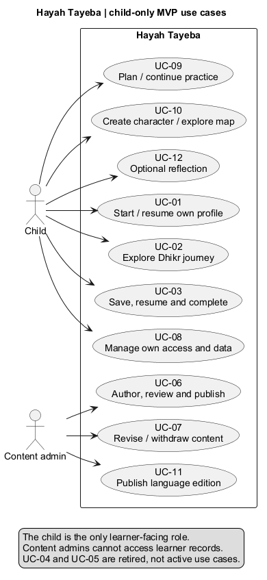
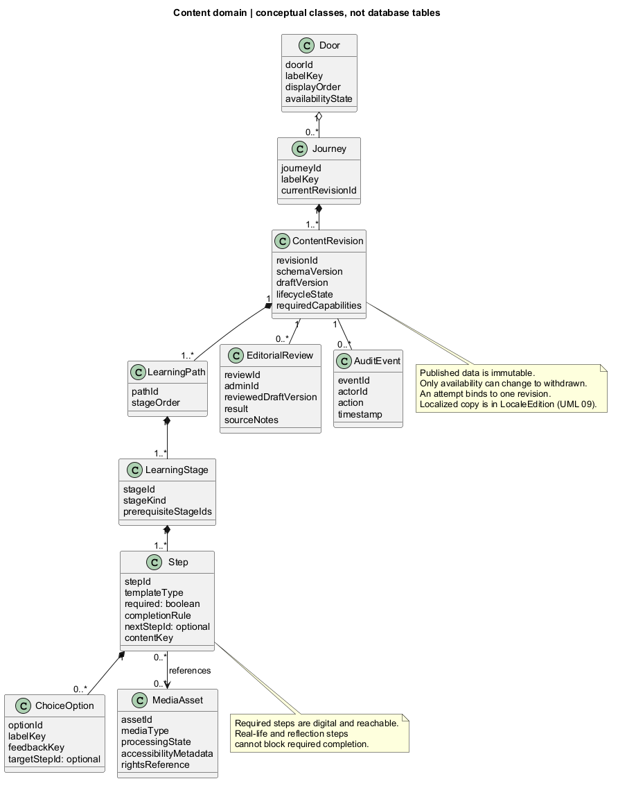
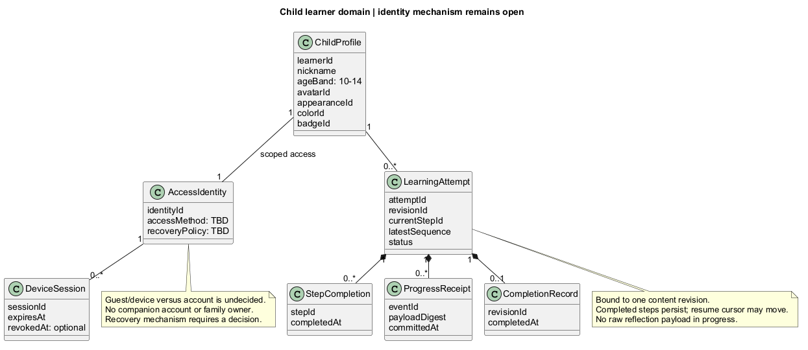
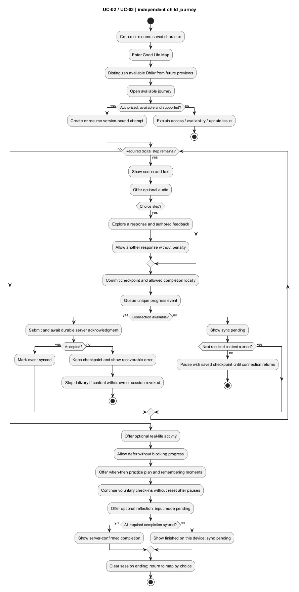
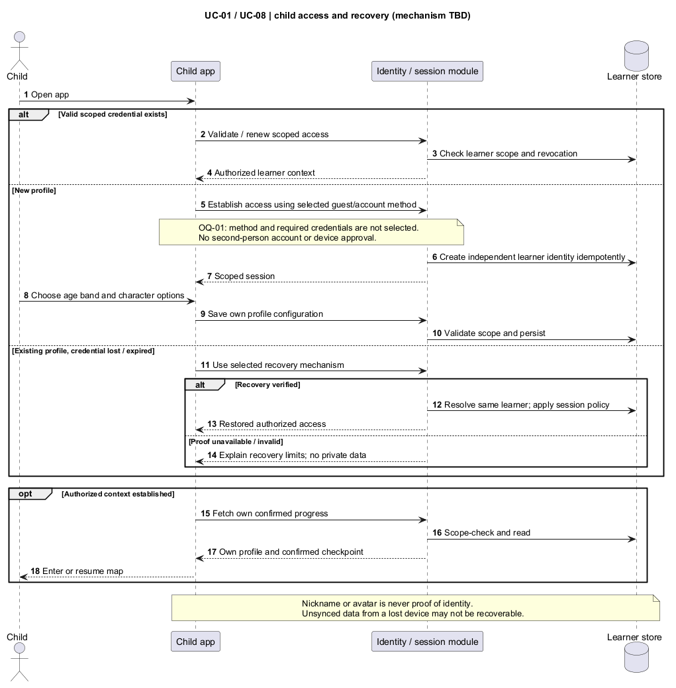
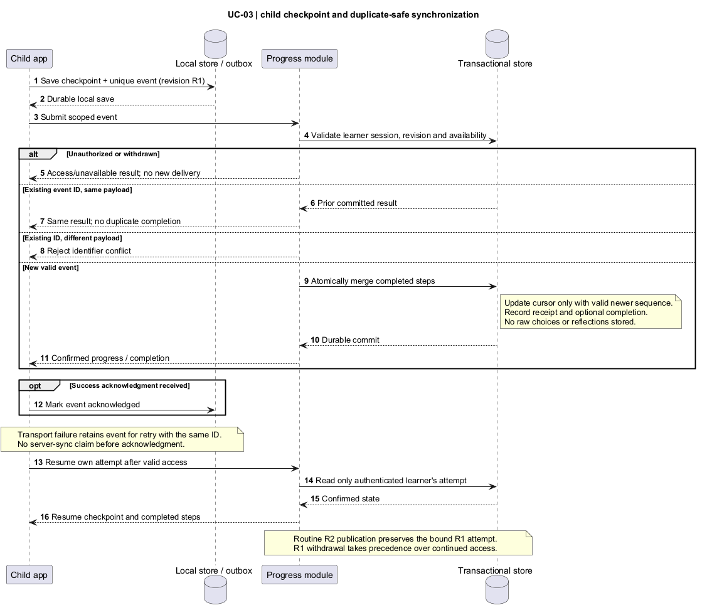
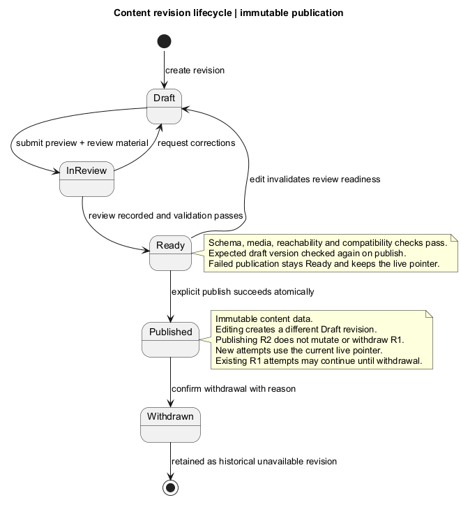
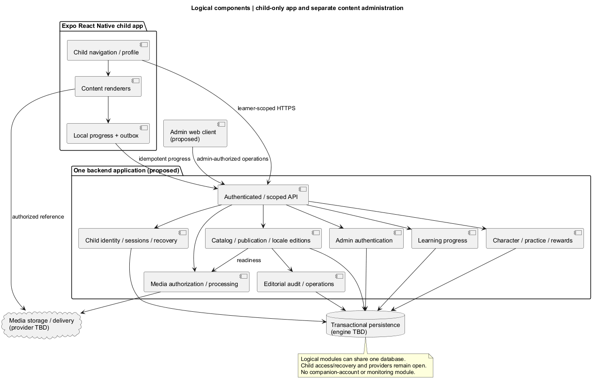
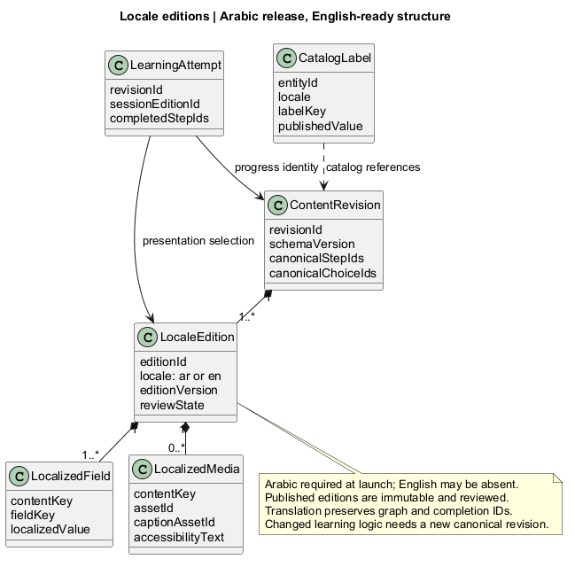
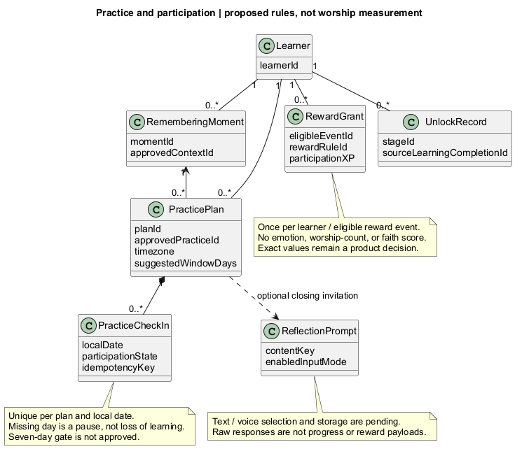

# UML model guide

Version 0.3 · These diagrams model the draft SRS, including explicitly proposed decisions.

Each diagram has editable PlantUML source and a locally rendered SVG. Diagrams describe software behavior and responsibilities; they are not UI mockups. Class diagrams are conceptual domain models, not a physical database schema. A component boundary does not imply a separately deployed service.

## 1. Use cases

Shows the child and content admin as the only current actors. Retired adult learning and monitoring use cases are excluded from the active model.

[Editable source](uml/01-use-cases.puml) · [Full-size SVG](diagrams/01-use-cases.svg)



## 2. Content domain

Separates a stable journey identity from its immutable published revisions. Child learning paths contain steps, which reference reusable media. Choice destinations and step reachability are validated before publication. The minimum multiplicities describe a valid publishable model; an incomplete draft may temporarily omit paths/steps.

[Editable source](uml/02-content-domain.puml) · [Full-size SVG](diagrams/02-content-domain.svg)



## 3. Learner domain

Each child is an independent learner with scoped access. Attempts bind to one revision; completion and resume position are distinct. The guest/account method, recovery, and simultaneous-device policy remain open.

[Editable source](uml/03-learner-domain.puml) · [Full-size SVG](diagrams/03-learner-domain.svg)



## 4. Child activity flow

Shows an independent learning session, local progress, network failure, optional activities, and a clear finish. The diagram does not promise full offline media access. Practice planning, remembering moments, and optional check-ins continue after digital learning; text/voice reflection mode is pending.

[Editable source](uml/04-child-activity.puml) · [Full-size SVG](diagrams/04-child-activity.svg)



## 5. Child access and recovery sequence

Shows new-profile access, session resumption, and recovery behavior without selecting a sign-in mechanism. No companion account or device approval appears in this model.

[Editable source](uml/05-child-access-sequence.puml) · [Full-size SVG](diagrams/05-child-access-sequence.svg)



## 6. Progress synchronization sequence

Distinguishes local save from server confirmation, handles duplicate events, and restores only the authenticated child's own progress. Raw answer histories and reflections do not cross this boundary under the proposed privacy policy.

[Editable source](uml/06-progress-sequence.puml) · [Full-size SVG](diagrams/06-progress-sequence.svg)



## 7. Content revision state machine

Review readiness is invalidated by a later edit. A published revision is never edited in place; its replacement is a different revision. Withdrawal affects availability and preserves historical records.

[Editable source](uml/07-content-state.puml) · [Full-size SVG](diagrams/07-content-state.svg)



## 8. Logical components

Shows mobile and proposed admin clients, a proposed modular backend, persistence, and media/identity dependencies. Vendor names and deployment topology intentionally remain open until requirements are reviewed.

[Editable source](uml/08-components.puml) · [Full-size SVG](diagrams/08-components.svg)



## 9. Localization model

Arabic release content and future English editions share canonical step/choice IDs. Published language editions are reviewed separately; translation does not reset progress or mutate the learning graph.

[Editable source](uml/09-localization.puml) · [Full-size SVG](diagrams/09-localization.svg)



## 10. Practice and rewards model

Proposed remembering moments, when/then plans, pause-friendly check-ins, participation XP, and learning unlocks. Reflection input/storage and mandatory seven-day gating remain open.

[Editable source](uml/10-practice-rewards.puml) · [Full-size SVG](diagrams/10-practice-rewards.svg)



## Re-rendering

The diagrams were authored for PlantUML. Local rendering uses Java and the downloaded renderer in the workspace's private `.codex-inspect/tools` folder; this is documentation tooling, not an application dependency. Keep generated SVGs for viewing without Java.

From the workspace root in PowerShell:

```powershell
& 'C:/Program Files/Java/jdk-17/bin/java.exe' '-Djava.awt.headless=true' -jar '.codex-inspect/tools/plantuml-mit-1.2026.8.jar' -charset UTF-8 -failfast2 -tsvg -o '../diagrams' 'docs/uml/*.puml'
```

Layout-heavy diagrams use the bundled Smetana layout engine. Tool references: [official PlantUML downloads](https://plantuml.com/download) and [Smetana configuration](https://plantuml.com/smetana02). Product requirements are sourced from this conversation and supplied materials, not those tooling references.
