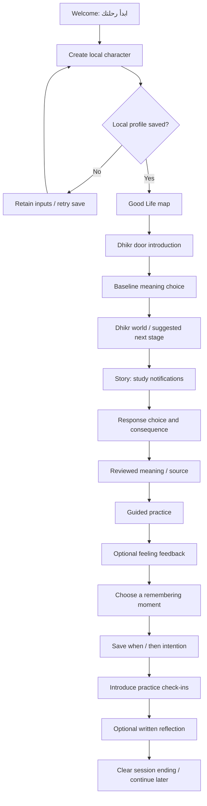

# Hayah Tayeba — offline MVP UX flows

Design working draft · 2026-10-05 · For ages 10–14 · Arabic / RTL

This document interprets the confirmed decisions in [v0.4](../revisions/v0.4/DECISIONS.md) and the [implementation plan](../planning/IMPLEMENTATION_PLAN.md). It does not modify or relock v0.3. Content examples, region names, pacing, and specific unlock prerequisites below are authoring hypotheses to validate with the content owner.

## Experience intent

The child creates a character, enters the map, explores one complete Dhikr door, tries a small practice, chooses a daily remembering moment, and reaches a clear ending. Returning children can resume the learning route or return to their own remembering moments. The child acts independently. No login, mother journey, pairing, remote publication, online status, or streaming dependency appears in the MVP consumer interface.

First installed launch must work offline. A local profile stores character choices and progress; written reflections are local and optional. Skipping a reflection, reporting no emotional change, or missing a practice day never removes learning completion.

The story world is lightly fantastical and uses recognizable situations such as study distractions, friendship disagreements, and gratitude. Illustrations should feel suitable for preteens and young teens. Character development represents participation in the journey and does not certify faith, spiritual merit, or habit formation.

## Proposed information architecture

Three top-level destinations provide stable anchors:

- **الخريطة**: the full Good Life map and entry to Dhikr.
- **لحظاتي**: chosen remembering moments, practical intention, and practice history.
- **دفتر الرحلة**: optional written reflections and drafts.

The avatar in the header opens **شخصيتي**; settings are reached there or through a clearly labelled settings action. During stories, video, or practice, navigation reduces to contextual back/close and the next meaningful action. It returns to the same scroll and map position. The keyboard never hides reflection save actions.

One active local profile per installation is a proposed MVP simplification, not a newly approved product requirement. There is no profile chooser, account migration screen, or implicit cloud backup. A subsequent need for multiple children on one device requires an explicit profile model and local isolation.

## Primary first-use route

This is an opening-session hypothesis, not the full curriculum condensed into one short story. The full door uses the same reusable scene, choice, meaning, and practice screens for every reviewed contextual stage. Its final completion screen is reachable only after the required digital learning steps are saved. Choosing a moment creates an intention; it does not claim the child has already performed the practice.

## Full door structure and progression

The proposed learning regions are a way to organize the supplied source, not a fixed stage count:

| Region / stage | Child purpose | Templates | Completion basis |
|---|---|---|---|
| **بوابة الذكر** | Enter the world and express an initial idea | Entry, choice | Entry participation; initial choice is not graded |
| **منطقة الاكتشاف** | Understand Dhikr in a familiar situation | Story, choice, meaning | Reach reviewed learning checkpoints |
| **ساحة التجربة** | Try an approved small guided practice | Practice, optional feedback | Complete or advance through the digital practice; no emotional target |
| **حديقة اللحظات** | Explore daily contexts and make one intention | Moments, plan | Save a chosen context/intention; real-world performance is separate |
| **مسارات أعمق** | Explore remembering inwardly, gratitude, and difficult situations | Reused story, choice, meaning, practice | Authored learning prerequisites only; content examples need editorial review |
| **مكان التأمل** | Review what was learned and choose where to continue | Optional reflection, completion | Required digital route complete; writing is optional |

Practice history can continue after digital completion. The designed history has no seven-day hard gate, compulsory streak, missed-day countdown, fixed XP amounts, or worship counters. If approved later, optional learning rewards can use the keepsake area without changing the core route. The MVP design uses unnumbered keepsakes and clear learning checkpoints.

### Two different kinds of closed doors

1. **A bundled Dhikr region with learning prerequisites:** show a lock, the region name, and a specific actionable explanation, such as «افتحه بعد إكمال حكاية التشتت». Selecting it explains the requirement and offers «اذهب للخطوة المطلوبة». Once saved prerequisites are met, it opens. Replaying earlier content remains possible.
2. **A future independent door such as معية الله:** show a distinct preview style, «غير متاح في هذه النسخة», and a short description. Selecting it opens an information sheet with «رجوع للخريطة». It has no progress fraction, mission requirement, points price, or unlock promise. It cannot accidentally become accessible when Dhikr is completed.

The visual designs should preserve the client's locked-door map idea while making this distinction obvious. Future preview selection never interrupts the current Dhikr checkpoint.

## Returning-child routes

**Return to learning:** launch → map → **كمّل رحلتك** → last committed story/activity checkpoint. Completed introductory screens are not repeated. A playback position may be resumed where available, with captions and playback controls intact. The child can use **من البداية** for an intentional replay.

**Return to a practice intention:** launch → **لحظاتي** → saved intention → optional **سجّل تجربتك** → check-in → confirmation. «جربت»، «افتكرت من نفسي»، and «لسه ما جربتش» represent self-report; all are accepted without grading. Skipping returns to the moment. Check-in history records practice independently of the learning route.

**Return to a written draft:** launch → **دفتر الرحلة** → **مسودة** → edit → save. Drafts recover after an ordinary app restart. The child decides when a draft becomes a saved reflection. Back navigation offers save draft, discard new changes, or continue writing if a change is not safely persisted.

**After door completion:** the map shows **اكتملت رحلة التعلم** with actions **ارجع لحظاتي** and **استكشف الحكايات مرة تانية**. A visual tree/keepsake recalls the completed journey. It does not say the child is now more faithful or has permanently established a habit. Future previews stay unavailable.

## Written reflection behavior

Use one reflection editor with one prompt at a time. Example prompts from the client proposal:

- «إمتى كان الذكر أسهل بالنسبة لك؟»
- «إمتى كان أصعب؟»
- «تحب الذكر يكون جزء من أي وقت في يومك؟»

The editor supports write, save draft, save reflection, reopen, edit, delete, and skip. Existing written drafts are surfaced with a simple **مسودة** label, not notifications that create urgency. Reflections are neither scored nor exposed in a leaderboard or content dashboard. The interface offers **مش حابب أكتب دلوقتي** without warning or loss.

Save status uses explicit text: **جارٍ الحفظ…**, then **اتحفظت على الجهاز** only after successful persistence. A failed save retains visible text and offers retry; it never clears the field or silently marks the reflection saved. No microphone, voice upload, AI analysis, sentiment score, or recommendation based on private text is designed.

The final field length is an implementation setting. If a limit is necessary, expose it before typing, keep the counter accessible, reject only excess input, and preserve the rest. Do not introduce an arbitrary required minimum. Empty **حفظ التأمل** does not create a blank saved entry; the child can skip instead.

## Failure and interruption contract

| Situation | Child experience | Recovery |
|---|---|---|
| Normal offline use | No offline warning or network banner | Entire route works from bundled assets |
| Setup save fails | «ما قدرناش نحفظ شخصيتك. اختياراتك لسه موجودة.» | Retry without resetting choices; no fake saved profile |
| Checkpoint save fails | «تقدمك لسه ما اتحفظش.» | Retry; do not advertise the next stage as unlocked until its prerequisite is saved |
| Reflection save fails | Text stays visible; «كلامك لسه هنا، لكن ما اتحفظش.» | Retry or safely remain in editor; unsaved-change decision before leaving |
| Force-stop / relaunch | Load last saved checkpoint and local drafts | Never reset the whole door because one pending write was interrupted |
| Missing packaged media | «المشهد مش متاح في النسخة دي.» | Retry loading local asset or return to the map; flag as a packaging defect, never ask the child to connect |
| Planned optional narration is absent | Text/captions remain usable; unavailable audio action is removed | Only optional media can fall back without blocking content |
| Deliberate content replay | «هتشوف الحكاية من الأول. تقدمك محفوظ.» | Replay does not duplicate a reward or erase reflections |
| Corrupt/unreadable local record | Explain load failure and offer retry without immediate deletion | Destructive recovery is a separate confirmed reset; preserve recoverable data |

For packaged media required to convey the learning content, a missing asset is not papered over with a silent auto-completion. QA must detect it before delivery. The error view stays usable and does not turn the entire app into a blocked modal.

## Local settings and reset

Settings include audio preferences, caption/readability controls supported by the build, reduced motion, local storage explanation, and reset. Exact controls depend on the implementation and must work with the device accessibility settings.

Use **بياناتي على الجهاز** with plain copy: «شخصيتك وتقدمك وكتاباتك محفوظين على الجهاز ده. حذف التطبيق أو مسح بياناته ممكن يمسحهم.» Do not suggest remote recovery, sync, or upload.

**مسح التأمل** deletes only one selected written entry. Confirmation: «تمسح التأمل ده؟ مش هنقدر نرجّعه.» Actions: **احتفظ به** / **امسح التأمل**. Keep progress untouched.

**ابدأ من جديد** is a separate full local reset. Explain exactly: «ده هيمسح شخصيتك وتقدمك ولحظاتك وكتاباتك من الجهاز.» Actions: **رجوع** / **امسح بياناتي وابدأ من جديد**. Require a deliberate confirmation step and avoid accidental swipe/tap dismissal triggering deletion. Reset success returns to welcome; failure retains current state and provides retry. No cloud account or server erasure is implied.

## Interaction and language rules

- One clear primary action per learning screen; meaningful options remain readable without tiny type.
- Narrative choices receive consequences and explanatory feedback, not red crosses or humiliating failure language.
- «ما حسّيتش بفرق» is a legitimate response after practice. The next step remains available.
- Progress describes completed learning; practice describes self-reported attempts. No «ثبت أنك ذكرت الله» request.
- Avoid ordinary push reminders in this MVP design. Opening **لحظاتي** is sufficient; scheduled notifications would be a separate addition.
- Use logical RTL leading/trailing layout and test Arabic with numbers and punctuation. Media play/pause symbols retain their universal orientation.
- Touch targets should accommodate young users; controls have text labels, predictable focus, and screen-reader names. Captions and text provide access without sound. Audio playback is deliberate and pausable.
- Motion adds feedback rather than delaying actions. Reduced motion preserves the same information and completion rules.
- Do not fabricate Qur'an quotations or claim guaranteed calm. Religious quotations and explanations come from reviewed content entries, with source available on the meaning screen.

## Review checkpoints before implementation

Validate these prototypes with children near both ends of the 10–14 range: create a character unaided; find the next step; explain a future unavailable door vs a learning-locked region; choose and later find a remembering moment; skip/write/reopen a reflection; resume after closing the app. Observe comprehension and comfort rather than judging devotion. Content-owner review covers every religious quotation, explanation, scene, and practical instruction. None of those reviews require reopening the deferred login discussion.

