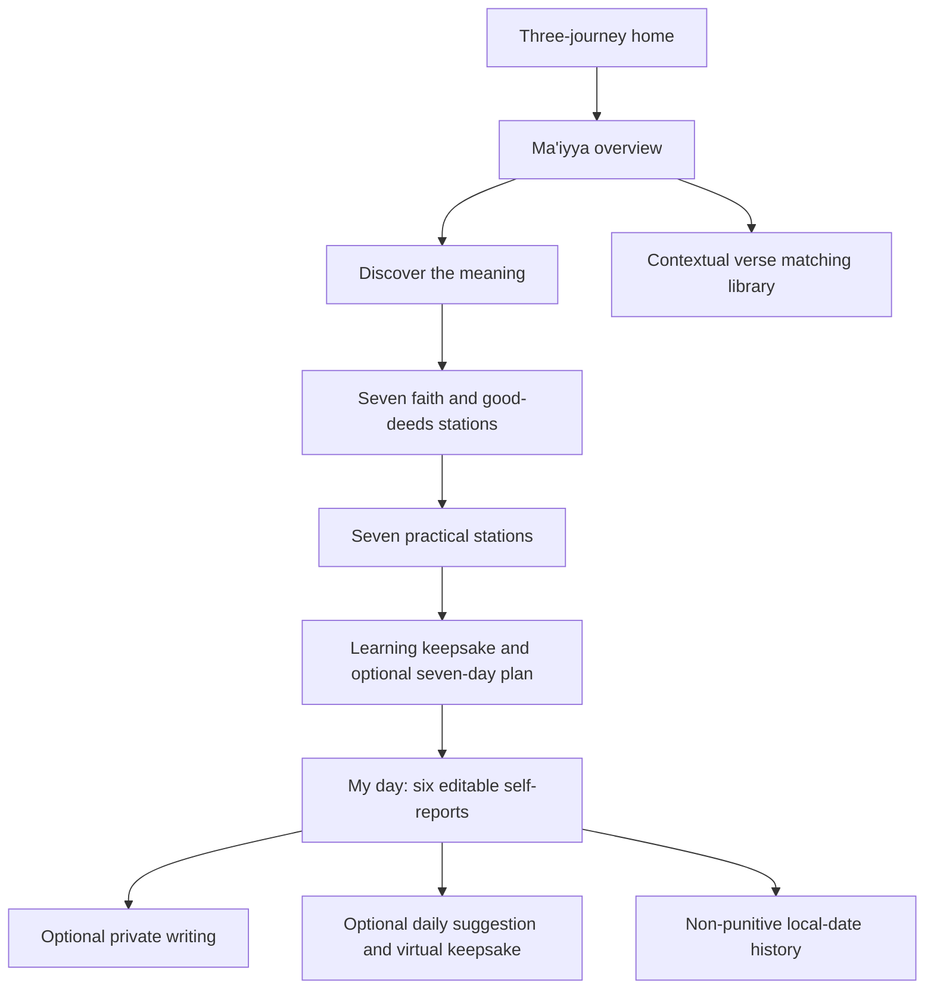

# v0.7 data and flow contracts

## Content

Canonical journey ID `maiyya`, `kind: maiyya`, fifteen stable station IDs in three chapters. Every verse has text, reference, source URL and context. The six matching exercises identify a verse, three doors, a suitable door index, an application question and its suitable answer. Four exercises bind to stations; two are additional library activities. Narratives permit exploring any answer; matching/classification checks educational associations with unlimited retries.

## Learner schema 4

The existing storage key stays unchanged. Dispatch version 4 before validating against the new three-journey configuration. Version 3 upgrades clone its existing state and add `journeys.maiyya`; versions 1/2 still migrate through their established paths. No current Tazkiya completion is archived/reset during this addition.

Ma'iyya keeps normal completed IDs, badge IDs, checkpoint and activity drafts, plus:

- `started`: opts returning participants into the daily landing screen.
- `matching`: per-exercise selections and earned educational completion.
- `daily[localDate]`: six editable booleans, at most one saved triangle suggestion and one dice result.
- `sevenDayPlan`: starting local date, preferred review time and six item IDs; never a completion gate.

The optional timer stores remaining seconds in its station activity. Navigation/backgrounding pauses it. It does not record observed worship, mood or sincerity.

Daily reflections use a dated canonical prompt ID and independent origin metadata, so diary editing does not require a current station screen. All written data remains local. Individual note deletion and reset purge raw `.backup-v1`, `.backup-v2`, `.backup-v3` copies as applicable. A failed commit retains prior committed state, never granting progression or rewards on failure.

No public network API, account, cloud data model or remote admin contract is introduced by this preview update.
